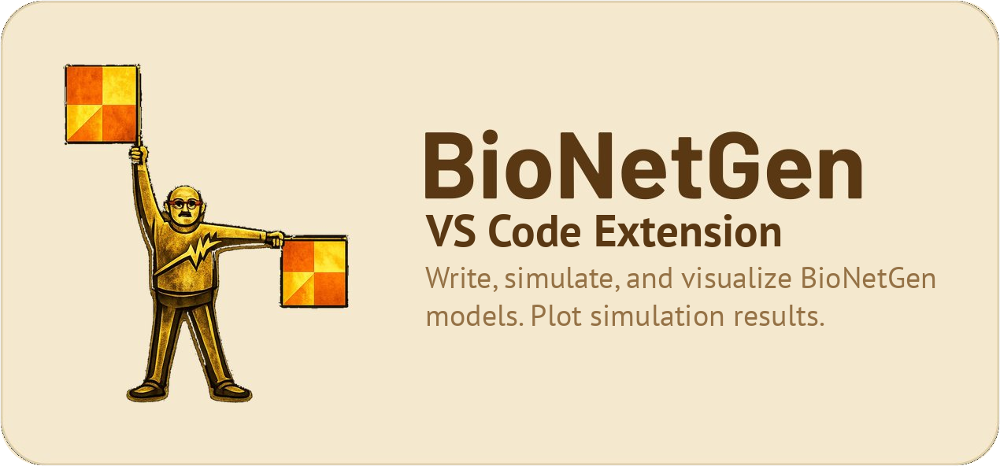

[](https://bng-vs-code-extension.readthedocs.io/en/latest/?badge=latest)

# BioNetGen (BNG) VS Code Extension

A [VS Code](https://code.visualstudio.com/) extension for the [BioNetGen](http://bionetgen.org/) rule-based modeling platform. Write, validate, simulate, and visualize BioNetGen models without leaving the editor. See the [starter guide](docs/guide.md) for an introduction.

## Features

* **Syntax Highlighting:** Scoping for all BNGL constructs, with dark, light, and high-contrast themes.
* **Language Server:** Real-time diagnostics (mismatched blocks, duplicate definitions, unused parameters), autocomplete for block types, actions, parameters, molecule types, and [built-in functions](docs/bngl-grammar.md#built-in-functions), go-to-definition, find references, and hover information.
* **Intelligent Folding:** Fold `begin/end` blocks and metadata sections.
* **Simulation:** Run BioNetGen simulations directly from the editor and monitor processes in a sidebar tree view.
* **Network Visualization:** Generate contact maps, rule visualizations, and regulatory graphs, then inspect GraphML output in a built-in viewer with layout switching, day/night view toggles, and export actions.
* **Interactive Plotting:** Plot `.gdat`/`.cdat`/`.scan` results with a built-in viewer featuring variable selection, axis scale toggles, line style controls, a day/night view toggle, and sharper PNG/SVG export.
* **Snippets:** Expand block skeletons, line templates, action calls, and math functions with `Tab`.

## Usage

1. Open or create a `.bngl` file. Syntax highlighting and language server features activate automatically.
2. Click the **BioNetGen icon** in the editor title bar to open the command menu. Depending on the active file, the dropdown can show:
   - **Simulate**, **Contact Map**, **Regulatory Graph**, **All Graphs**, and **Results Folder...** for `.bngl` files
   - **Plot** for `.gdat` / `.cdat` / `.scan` files
   - **View** for `.graphml` files
   - **Install** and **Upgrade** for PyBioNetGen management
3. After a simulation completes, the resulting `.gdat` file opens automatically. Click the BioNetGen icon to launch the interactive plot viewer.
4. Use **Contact Map** or **Regulatory Graph** to generate just that GraphML output, or **All Graphs** when you also want the full contact-map, rule-visualization, and regulatory set.
5. Generated GraphML files can be opened in the built-in viewer, where you can switch layouts directly, lock or unlock the layout, use **Scale to Fit**, toggle day/night mode, save the graph as PNG, and save a GraphML copy with the current node layout from the toolbar. Contact maps also include show/hide toggles for components and internal states.
6. Use the **sidebar controls** in the plot viewer to toggle variables on/off, switch axis scales (linear/log), change line styles, toggle the legend, and export images.

## Requirements

The editing features (highlighting, diagnostics, autocomplete, navigation) work out of the box. To run simulations and visualizations you also need:

* VS Code 1.82 or newer
* [Python 3](https://www.python.org/) (we recommend [Anaconda](https://docs.anaconda.com/anaconda/))
* [PyBioNetGen](https://github.com/RuleWorld/PyBioNetGen) (`pip install bionetgen`)
* Perl (Windows users: `conda install -c conda-forge perl`)

The extension's **Install** and **Upgrade** actions keep `setuptools<82` pinned for now, because current PyBioNetGen releases still import `pkg_resources`.

## Installation

The extension is available on the [VS Code Marketplace](https://marketplace.visualstudio.com/items?itemName=BioNetGen-ext.biontegen-vscode-extension): search for **BioNetGen** in the Extensions tab.

If you previously installed the older **BioNetGen Language** extension (`als251.bngl`), uninstall it first: that listing is no longer updated, and the two extensions conflict if both are installed.

For installation from a VSIX package or running from source, see the [installation guide](docs/install.md).

## Snippets

Type a prefix and press `Tab` to expand. All snippets are available in `.bngl` files.

### Block Snippets

| Prefix | Description |
|--------|-------------|
| `begin model` | Full model skeleton with all standard blocks |
| `begin parameters` | Parameters block |
| `begin molecule types` | Molecule types block |
| `begin compartments` | Compartments block |
| `begin seed species` | Seed species block |
| `begin species` | Species block |
| `begin observables` | Observables block |
| `begin functions` | Functions block |
| `begin reaction rules` | Reaction rules block |
| `begin population maps` | Population maps block |
| `begin energy patterns` | Energy patterns block |

### Line Snippets

| Prefix | Description |
|--------|-------------|
| `Molecule` | Molecule with component and state |
| `MoleculeType` | Molecule type definition with two states |
| `Species` | Species pattern with bond |
| `CompartmentLine` | Compartment definition |
| `ParameterLine` | Parameter name/value pair |
| `SpeciesLine` | Species with amount |
| `ObservableLine` | Observable (Molecules or Species) |
| `FunctionLine` | Function definition |
| `RuleLine` | Reaction rule with rate |
| `EnergyPatternLine` | Energy pattern with expression |
| `PopulationMapLine` | Population map rule |

### Action Snippets

| Prefix | Description |
|--------|-------------|
| `generate_network` | Generate network action |
| `generate_hybrid_model` | Generate hybrid model action |
| `simulate` | Simulate with method, t_end, n_steps |
| `parameter_scan` | Parameter scan with all options |
| `bifurcate` | Bifurcation analysis |
| `readFile` | Read file action |
| `writeFile` | Write file (bngl/net/xml) |
| `writeModel` | Write model |
| `writeNetwork` | Write network |
| `writeXML` | Write XML |
| `writeSBML` | Write SBML |
| `writeMfile` | Write M-file |
| `writeMexfile` | Write MEX-file |
| `writeMDL` | Write MDL |
| `visualize` | Visualize action |
| `setConcentrations` | Set species concentration |
| `addConcentration` | Add to species concentration |
| `saveConcentrations` | Save current concentrations |
| `resetConcentrations` | Reset concentrations |
| `setParameter` | Set parameter value |
| `saveParameters` | Save current parameters |
| `resetParameters` | Reset parameters |
| `setModelName` | Set model name |
| `substanceUnits` | Set substance units |
| `version` | Set version |
| `setOption` | Set option |
| `quit` | Quit action |

### Math Functions

`abs`, `sin`, `cos`, `tan`, `exp`, `ln`, `log10`, `floor`, `ceil`, `sqrt`, `asin`, `acos`, `atan`, `sinh`, `cosh`, `tanh`, `asinh`, `acosh`, `atanh`

## Settings

| Setting | Description | Default |
|---------|-------------|---------|
| `bngl.general.auto_install` | Automatically install PyBioNetGen on activation | `true` |
| `bngl.general.enable_terminal_runner` | Use the old terminal-based runner instead of spawning processes | `false` |
| `bngl.general.auto_open` | Automatically open result files (e.g. `.gdat`) after a simulation run | `true` |
| `bngl.general.result_folder` | Absolute path to a default results folder (used when no workspace is open) | `null` |
| `bngl.plotting.legend` | Show the plot legend by default | `true` |
| `bngl.plotting.max_series_count` | Maximum number of time series to display initially | `50` |

## Development

See the [developer guide](docs/source/developers.rst) for architecture details and build instructions. Quick start:

```
npm install
npm run watch   # start build in watch mode
# Press F5 to launch the Extension Development Host
```

Please submit issues and feature requests at [GitHub](https://github.com/RuleWorld/BNG_vscode_extension/issues).

## Resources

* [Starter guide](docs/guide.md)
* [Installation guide](docs/install.md)
* [BNGL grammar reference](docs/bngl-grammar.md)
* [Example models](examples/)
* [Developer guide](docs/source/developers.rst)
* [ReadTheDocs](https://bng-vs-code-extension.readthedocs.io/en/latest/)
